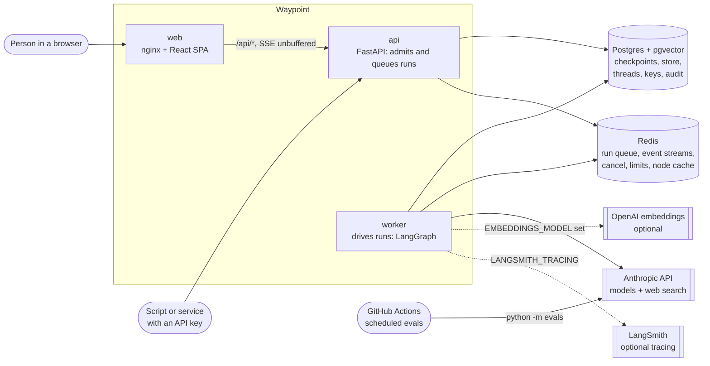
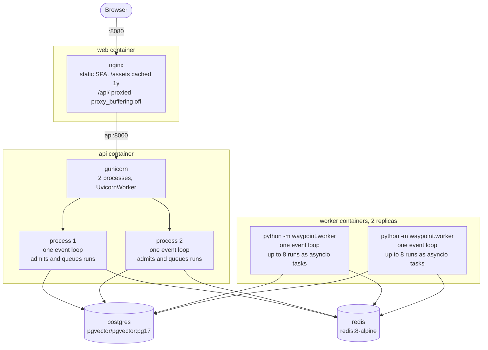
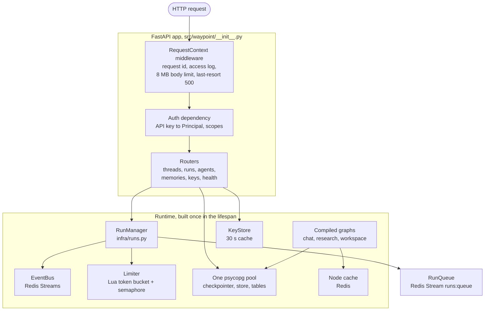
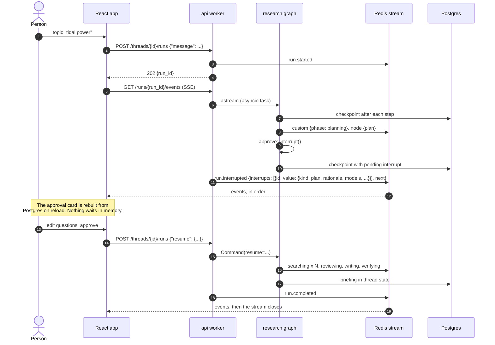

# 1. Overview

## What Waypoint is

Waypoint is a service for running LLM agents as durable, observable jobs. A
client starts a run and gets an id back at once. The agent's work streams to
any number of watchers. The run can pause for a person and resume days later,
and any past step can be rewound to and run down a new branch. It is a FastAPI
and LangGraph backend with a React frontend, on Postgres and Redis.

Three agents ship with it, chosen because between them they exercise the hard
parts:

* **chat**: a tool-using assistant with long-term memory per tenant and user.
  A tenant is the customer organisation a user belongs to, and the outer
  isolation boundary ([6.2](06-security-and-operations.md#62-tenant-isolation)).
* **research**: plans a topic into questions, **stops for a person to
  approve or edit the plan**, searches the web with parallel workers, has a
  critic review the findings and ask follow-ups, writes a cited briefing, and
  checks every citation in it.
* **workspace**: chat over the user's documents. A thread picks a corpus, the
  model searches it with a `search_documents` tool, and replies come back with
  `[n]` citations checked by the research agent's verifier. It shares chat's
  memory; MCP tools and approval for tool calls are its next phases
  ([design](../design/tools.md)).

Around the agents sits an **evaluation harness** that scores them against a
dataset, with a judge model calibrated against human labels, a baseline that
CI gates on, and a replay store that makes iterating on one prompt cost cents
instead of dollars.

## Goals and non-goals

| Goals | Non-goals |
|---|---|
| A run survives a dropped connection, a page reload, an api deploy and a week-long pause | Surviving the loss of the worker running it: runs are queued and driven by workers, and recovering a dead worker's runs is the next phase ([design/queue.md](../design/queue.md), [decision 30](07-decisions.md#d30-a-run-queue-and-a-worker-service-that-drives-runs)) |
| Many clients can watch one run, and reconnect without losing or repeating an event | Exactly-once side effects in tools |
| Tenants are isolated in data, memory, cache and rate limits | Per-tenant model routing, SSO/JWT (both have a seam, neither is built) |
| Each model call site can use a different model, chosen per run | A general-purpose agent framework; agents are code |
| Agent quality is measured, gated in CI and cheap to iterate on | Human evaluation at scale; labels are a small calibration set |

## System context

The evals do not go through the HTTP API. The harness builds the same graphs
in process (section [5.3](05-evaluation.md#53-the-pipeline)), so it measures
the agents and nothing else.

## Deployment

`compose.yaml` runs six services: the five below and `notes`, the demo MCP
server Workspace calls for its notes tools (from the api's image, on the
compose network only). The same images run anywhere that has
Postgres 17 with pgvector and Redis.

The api accepts a run, puts it on a Redis queue and returns; a worker takes it
off and drives the graph ([2.6](02-runs.md#26-the-run-queue-and-the-workers)).
Two of each is the default because the work is I/O bound: concurrency comes
from the event loop, not from processes. A run accepted by api process 1 and
driven by worker 2 can be watched and cancelled through api process 2,
because everything a watcher needs lives in Redis (chapter
[2](02-runs.md)).

## Inside one api process

The api's `RunManager` admits a run and queues it; with Redis it never drives
one. A worker process builds the same runtime with `role="worker"`, minus the
HTTP app, and adds a `RunWorker` that takes runs off the queue and drives the
compiled graphs. Without Redis the api builds that `RunWorker` itself.

Everything in the runtime box is bound to the process's event loop and is
created once, before the first request, by FastAPI's lifespan
(`src/waypoint/__init__.py`, which calls `start_runtime` in
`src/waypoint/agents/runtime.py`). That is the reason the service is ASGI and
not WSGI ([decision 1](07-decisions.md#d1-asgi-fastapi-one-event-loop-per-worker)).

## Code map

| Path | Responsibility |
|---|---|
| `src/waypoint/__init__.py`, `asgi.py` | App factory and lifespan: build the runtime, register routers and error handlers |
| `src/waypoint/middleware.py` | Request id, access log, body size limit, last-resort 500 (plain ASGI) |
| `src/waypoint/errors.py` | RFC 9457 problem responses with stable slugs |
| `src/waypoint/settings.py` | Every setting, typed and validated; `__` nests (`LIMITS__RPM`) |
| `src/waypoint/api/` | HTTP routers: thin, validate and delegate |
| `src/waypoint/infra/runs.py` | Run orchestration: start, drive, emit, stream, cancel |
| `src/waypoint/infra/bus.py` | Run events in Redis Streams; cancel over pub/sub; in-memory fallback |
| `src/waypoint/infra/ratelimit.py` | Per-tenant token bucket and concurrency semaphore, each one Lua script |
| `src/waypoint/infra/security.py` | API keys (hashed), principals, scopes |
| `src/waypoint/infra/threads.py` | Thread ownership, the one thing LangGraph does not track |
| `src/waypoint/infra/db.py`, `cache.py` | Postgres pool and migrations; Redis-backed LangGraph node cache |
| `src/waypoint/agents/registry.py` | The agent table; everything else reads from it |
| `src/waypoint/agents/graphs/` | The chat, research, workspace and ingest graphs |
| `src/waypoint/agents/memory.py` | Long-term memory recall for chat and workspace |
| `src/waypoint/agents/verify.py` | Citation checking, shared by research and workspace |
| `src/waypoint/agents/tools.py` | Tools: time, arithmetic, memory, and workspace's `search_documents` |
| `src/waypoint/agents/models.py` | Model construction, role routing, structured output, the scripted test model |
| `src/waypoint/agents/citations.py` | Sources from citation metadata, quotes, numbering, sentence splitting |
| `web/src/` | React 19 SPA: SSE client, run hook, approval card, research progress, time travel |
| `evals/` | Datasets, checks, rubrics, judge, calibration, scorecards, baselines, replay |

## Following one research run

## Quality attributes and where they come from

| Attribute | Mechanism | Chapter |
|---|---|---|
| Runs outlive requests and connections | Runs are tasks; events go to a Redis Stream; SSE is a reader | [2](02-runs.md) |
| Recovery after worker loss | Redis reclaim, fenced ownership and Postgres checkpoints | [2.6](02-runs.md#26-the-run-queue-and-the-workers) |
| Lossless reconnection | Stream ids are the SSE `Last-Event-ID` | [2.3](02-runs.md#24-reconnection) |
| Pauses survive restarts | `interrupt()` checkpoints to Postgres and ends the run | [3.3](03-state-and-persistence.md#33-interrupts) |
| Rewind and branch | Every super-step is a checkpoint; writing to an old one forks | [3.4](03-state-and-persistence.md#34-time-travel) |
| Tenant isolation | Identity in context, never state; ownership table; cache keys carry tenant | [3.5](03-state-and-persistence.md#35-context-state-and-config), [6.2](06-security-and-operations.md#62-tenant-isolation) |
| Fair use | Atomic Lua limits; a run's slot is taken before the POST returns | [6.3](06-security-and-operations.md#63-rate-and-concurrency-limits) |
| Model choice per call site | Roles resolved once per run; nodes never name a model | [4.3](04-agents.md#43-model-roles) |
| Trustworthy citations | Sources from API metadata, never from prose; a verifier checks each sentence | [4.6](04-agents.md#46-citations-from-metadata), [4.7](04-agents.md#47-the-verify-step) |
| Measurable quality | Datasets, checks, a calibrated judge, a gated baseline | [5](05-evaluation.md) |
| Affordable iteration | Record/replay keyed on exactly what reaches the API | [5.9](05-evaluation.md#59-replay) |
