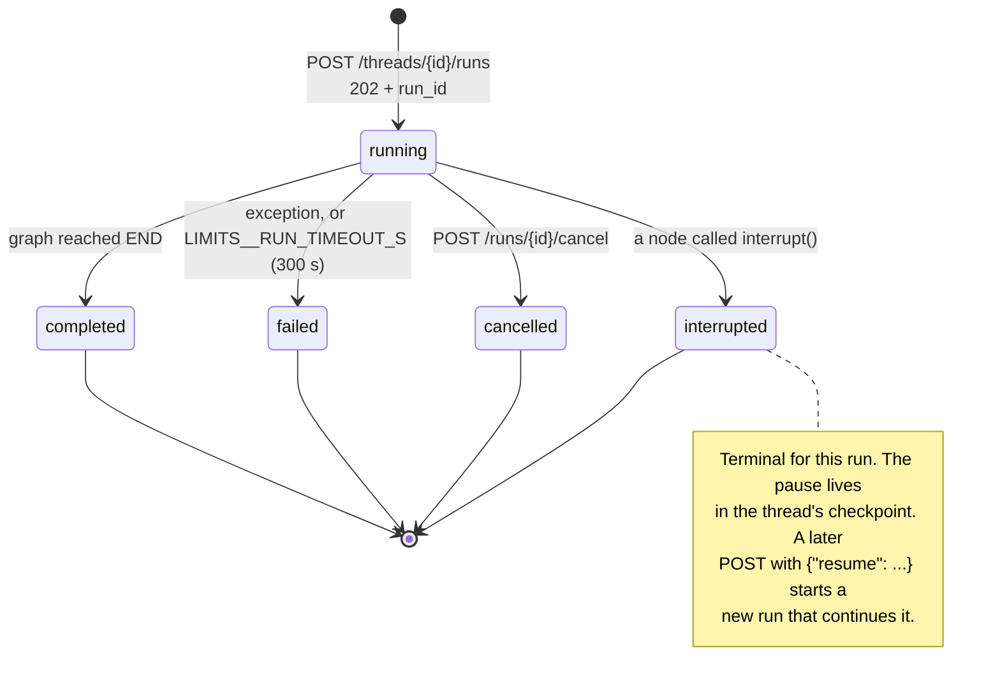
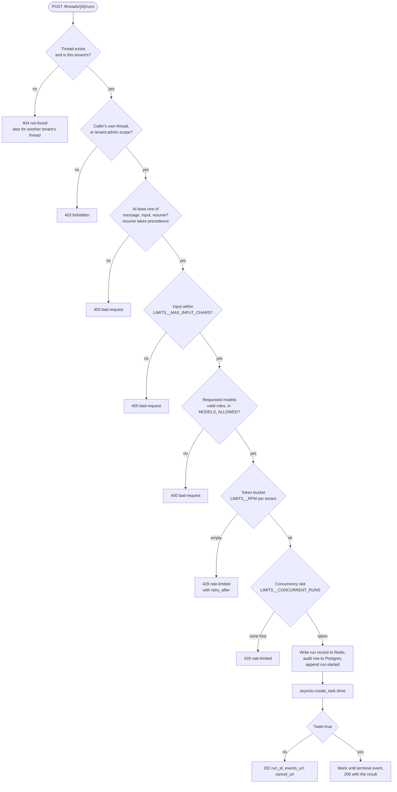
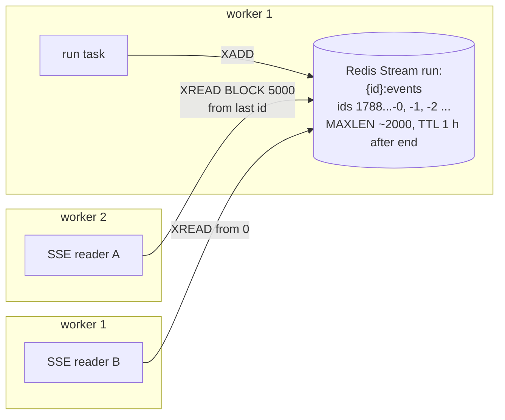
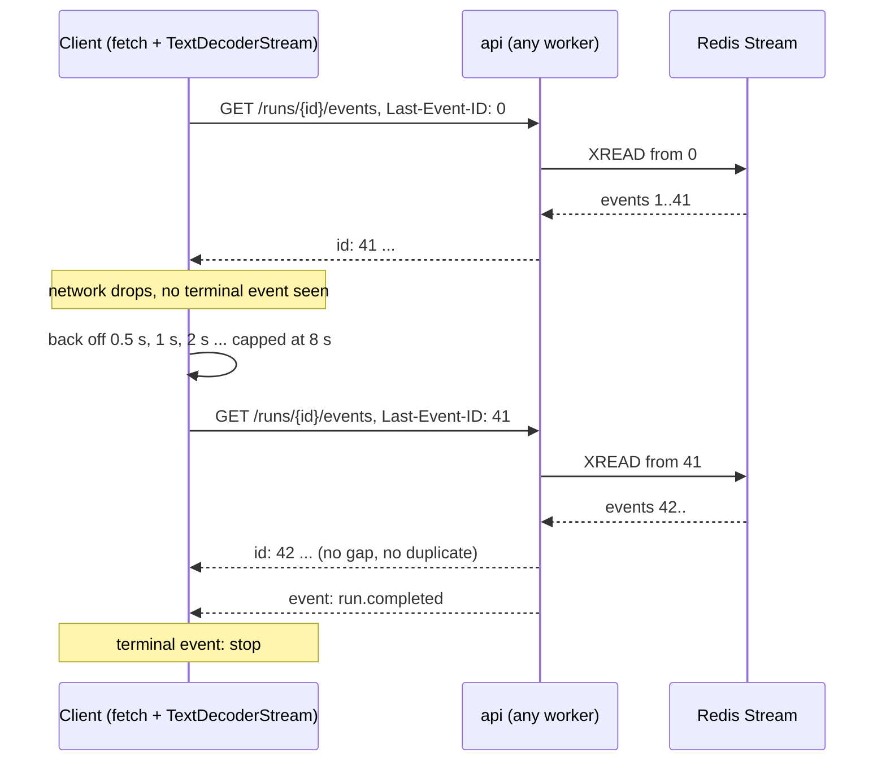
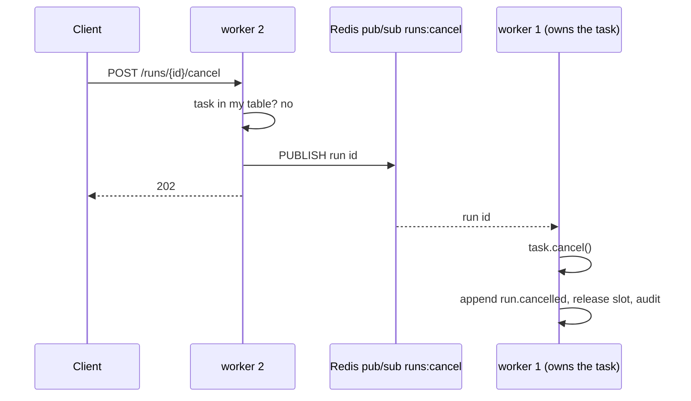

# 2. Runs

`src/waypoint/infra/runs.py`, `src/waypoint/infra/bus.py`, `src/waypoint/api/runs.py`.

A **run** is one execution of an agent's graph on a thread: from a start
request until the graph finishes, fails, is cancelled, or pauses for a person.
A **thread** is the conversation the run belongs to; it outlives any one run
(chapter [3](03-state-and-persistence.md)).

The design rule for this chapter: **a run is not an HTTP request.** The naive
design runs the graph inside the POST that started it. Then a four-minute
research run needs a four-minute request, a dropped connection loses the work,
a proxy timeout kills it, and a second browser tab cannot watch it. Waypoint
separates starting a run from watching it.

## 2.1 Lifecycle

`interrupted` is a terminal state on purpose. A paused run holds nothing: no
task, no connection, no memory. Resuming is a new run with its own id, its own
event stream and, if the caller asks, its own model choices.

## 2.2 Starting a run

The concurrency slot is taken **before** the POST returns. An over-quota
caller gets a clean `429` from the request it made, instead of a run that
fails later for a reason it cannot see. If anything between taking the slot
and creating the task fails, the slot is released at once rather than left
for the lease to expire (`RunManager._abandon`).

`?wait=true` exists for scripts and tests. Real clients take the `run_id` and
stream.

## 2.3 Events and the stream

The run's task iterates the graph with three LangGraph stream modes and turns
each chunk into an **event** appended to a Redis Stream keyed by run id:

| LangGraph stream mode | Event | Payload |
|---|---|---|
| `messages` | `token` | text, and the node that produced it |
| `updates` | `node` | the node's state update, once that node finishes |
| `custom` | `custom` | whatever a node wrote with `get_stream_writer()`; the research agent reports each step as it *starts* |
| (from the run itself) | `run.started`, `run.interrupted`, `run.completed`, `run.failed`, `run.cancelled` | lifecycle; the last four are terminal |
| (from the reader) | `heartbeat` | keep-alive every 15 s (`STREAM__HEARTBEAT_S`) |

`node` events alone would leave a progress panel empty for the minute that
research workers spend searching, because a node's update arrives only when
it ends. The `custom` phase events (`planning`, `searching`, `reviewing`,
`writing`, `verifying`) fill that gap.

### Why Redis Streams

`XADD` gives every event a monotonic id, and `XREAD` can start from any id.
That is exactly the SSE `Last-Event-ID` contract. Pub/sub would deliver only
to whoever is subscribed at that moment, so a dropped connection would lose
events. A list would need its own id scheme. Streams also bound the backlog
(`STREAM__MAXLEN`, 2000 events) and expire with the run (`STREAM__TTL_S`, an
hour after it ends).

## 2.4 Reconnection

Two rules keep this honest (`tests/test_stream_resilience.py`):

* **A stream that stops is not a run that failed.** If reading the stream
  fails, the server ends the SSE response *without* a terminal event; it never
  invents `run.failed`. The client treats a close without a terminal event as
  a drop and reconnects. After its retries run out it reports an error that
  says the run may still be going.
* **The socket timeout must outlast the block.** A reader parks in
  `XREAD BLOCK` for up to `STREAM__BLOCK_MS` (5 s). redis-py applies its
  socket timeout to that read, and its default (5 s) equalled the block, so
  any run quiet for 5 s, such as workers searching the web, had its stream
  time out. `REDIS_SOCKET_TIMEOUT_S` is 30 s and settings refuse a block that
  is not at least 1 s shorter.

The browser cannot use `EventSource`, which cannot send an `Authorization`
header and cannot be aborted cleanly. `web/src/api/sse.ts` reads the stream
with `fetch` and parses frames itself, which is what lets it own
`Last-Event-ID` and tie the stream to a component's lifetime.

## 2.5 Cancellation across workers

Pub/sub is the right tool here, unlike for events: a cancel only matters to
the worker running the task, and that worker is subscribed for as long as the
task exists. A cancel for a run that already ended returns `409`.

## 2.6 Limits on a run

| Limit | Default | Enforced by |
|---|---|---|
| Run starts per tenant | 60 per minute (`LIMITS__RPM`) | Lua token bucket in Redis |
| Concurrent runs per tenant | 4 (`LIMITS__CONCURRENT_RUNS`) | Lua semaphore; lease = run timeout + 30 s |
| Wall-clock per run | 300 s (`LIMITS__RUN_TIMEOUT_S`) | `asyncio.timeout` around the graph |
| Super-steps per run | 40 (`LIMITS__RECURSION_LIMIT`) | LangGraph recursion limit |
| Request body | 8 MB | ASGI middleware, before parsing |

The research agent also bounds its own loop (rounds, follow-ups, searches per
worker); see [4.5](04-agents.md#45-the-research-agent).

## 2.7 Durability modes

The `durability` field on a start request is passed to LangGraph and decides
when checkpoints are written:

| Mode | Checkpoint written | Use |
|---|---|---|
| `sync` | before the next step starts | strongest; each step waits on Postgres |
| `async` (default) | in the background while the next step runs | normal use; a crash can lose the last step |
| `exit` | only when the run ends or pauses | cheapest; no mid-run history |

An interrupt is always durable: the graph cannot pause without writing the
checkpoint it will resume from.

## 2.8 What the run record holds

`GET /runs/{id}` returns the record kept in Redis under `run:{id}:meta`, next
to the event stream at `run:{id}:events`: `run_id`, `thread_id`, `agent`,
`tenant_id`, `user_id`, `status`, `created_at`, `error`, `models` (the
role-to-model map this run used) and, once the run ends or pauses, `usage`
(cost, tokens and searches per role and in total). The `run_audit` table in
Postgres keeps the durable part (ids, tenant, user, agent, status, error,
`started_at`, `ended_at`, and the cost, token and search totals with the
per-role breakdown in `usage`; not the models), outlives the stream's TTL,
and is indexed by thread and by tenant.

The cost comes from `waypoint.usage.Meter`, a LangChain callback handler that
`RunManager._drive` attaches to every run. Each chat model call reports its
usage to it, attributed to a role by the `model_role` metadata each role's
runnable carries, and is priced from `src/waypoint/prices.toml` (cache reads,
cache writes and long prompts at their own rates, web searches per request).
Embeddings and reranking are not chat model calls; the code that makes them
reports them through `METER`, a ContextVar holding the current run's meter.
