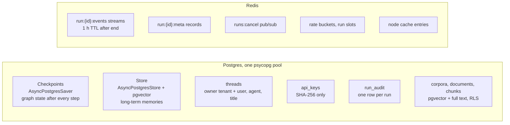
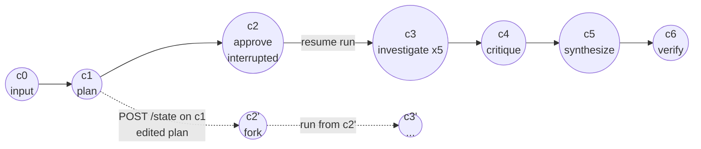
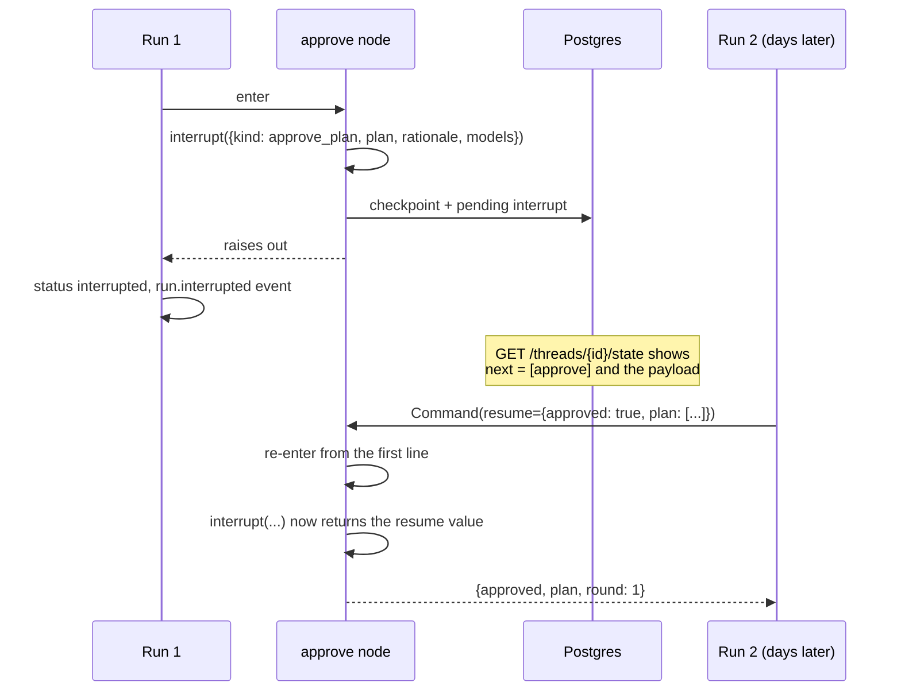
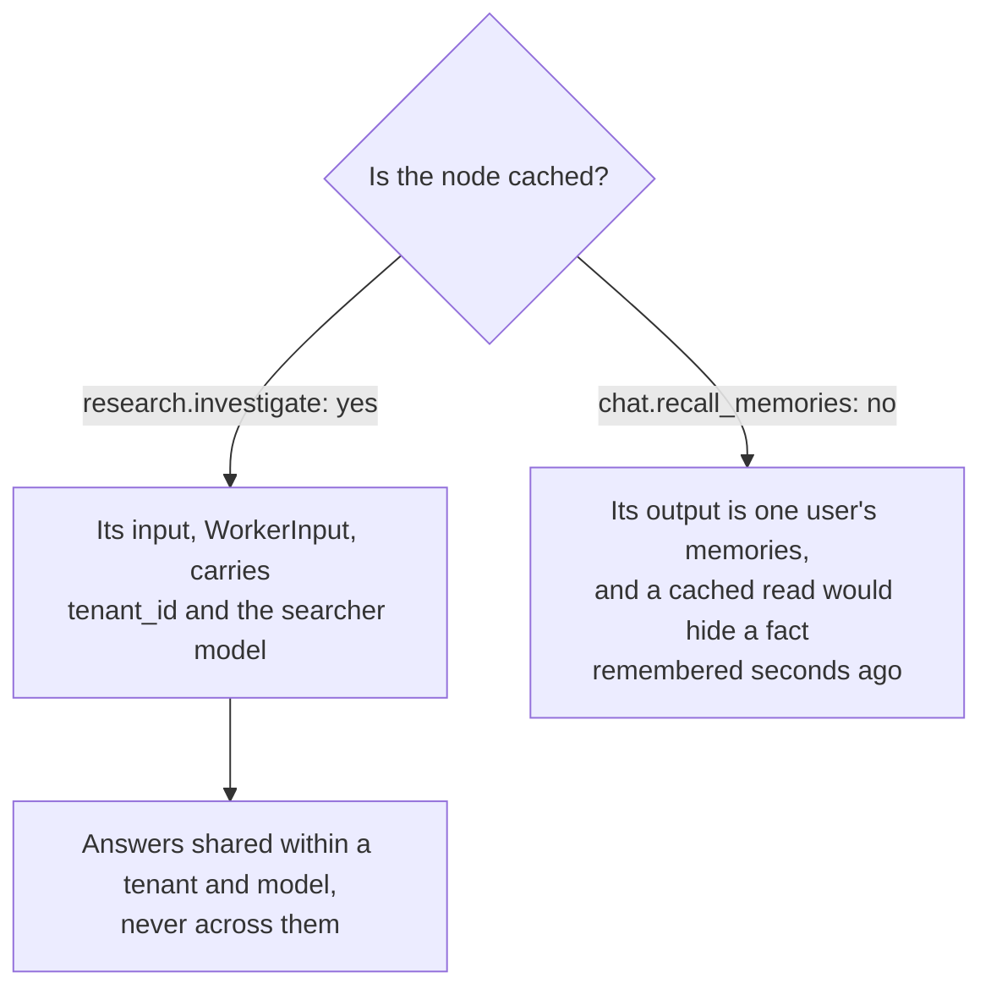

# 3. State and persistence

`src/waypoint/agents/state.py`, `src/waypoint/agents/context.py`,
`src/waypoint/infra/threads.py`, `src/waypoint/infra/db.py`,
`src/waypoint/infra/cache.py`.

## 3.1 What is stored where

| Data | Lives in | Lifetime | Why there |
|---|---|---|---|
| Graph state (messages, plan, findings, briefing) | Postgres checkpoints | as long as the thread | LangGraph's own persistence; enables interrupts and time travel |
| Long-term memories | Postgres store | until deleted | Cross-thread; semantic search needs pgvector |
| Thread ownership | `threads` table | as long as the thread | The checkpointer has no notion of an owner |
| API keys | `api_keys` table | until revoked | Hashed; the plaintext exists only in the create response |
| Corpora (RAG) | `corpora`, `documents` (with the uploaded bytes), `chunks` (with embeddings) | until the corpus is deleted | Retrieval in the same database and transactions as everything else; row-level security per tenant ([design/rag.md](../design/rag.md)) |
| Run events | Redis Streams | 1 h after the run ends | Ordered, replayable from any id, shared by workers |
| Run records | Redis, plus `run_audit` | Redis: same as events; audit: permanent | Fast status reads; durable history |
| Limits, cancel signals, node cache | Redis | seconds to minutes | Cross-worker and atomic |

The checkpointer, the store and Waypoint's own tables share **one**
connection pool: one number to size against `max_connections`, and no second
pool appearing under load.

## 3.2 Threads and checkpoints

A **thread** is a conversation with one agent. A **checkpoint** is a snapshot
of the thread's graph state, written after each **super-step** (one round of
nodes that run together). A thread's checkpoints form a tree: usually a
single line, branching when someone rewinds.

Every run in a thread continues from the thread's head checkpoint unless the
request names another one with `checkpoint_id`. One run owns the thread at
a time, including time queued and time waiting for worker recovery. A
competing run gets `409`. Recovery uses the recorded starting head to decide
whether to continue from a new checkpoint or replay the original input.

## 3.3 Interrupts

`interrupt(payload)` inside a node checkpoints the graph, stores the payload,
and raises out of the node. The run ends in state `interrupted`. Nothing
waits in memory, which is why the research approval card survives a reload,
a deploy or a week.

Two consequences:

* **The node runs again from its first line.** Everything before `interrupt()`
  executes twice. Side effects belong after it.
* **The resume value is user input.** The approve node accepts
  `{"approved": bool, "plan": [...]}` or a plain yes/no string, and caps an
  edited plan at five questions (`MAX_QUESTIONS`).

## 3.4 Time travel

Every checkpoint can be read (`GET /threads/{id}/state?checkpoint_id=`),
listed (`GET /threads/{id}/history`), and written to
(`POST /threads/{id}/state`). Writing to an old checkpoint creates a new
checkpoint on a new branch. `as_node` makes the write look as though that node
produced it, which decides where execution picks up. A run started with that
new `checkpoint_id` continues down the branch; the original line is
untouched. The UI's **Checkpoints** panel (`web/src/components/TimeTravel.tsx`)
is a front end for these three calls.

## 3.5 Context, state and config

LangGraph gives a node three inputs. Mixing them up causes real bugs, so each
has one job:

| | Holds | Mutable | Checkpointed | Examples |
|---|---|---|---|---|
| **State** | The conversation and the agent's working data | by nodes, through reducers | yes | `messages`, `plan`, `findings`, `report` |
| **Context** | Immutable facts about this run | no | no | `tenant_id`, `user_id`, `request_id`, `run_id`, `models` |
| **Config** | Plumbing | no | partly (metadata) | `thread_id`, `checkpoint_id`, recursion limit, callbacks, tags |

**Identity goes in context, never state.** If the tenant or user were state,
they would be checkpointed into the thread, and a replay months later would
run as a snapshot of who the caller used to be. Memory namespaces derive from
context, which is what keeps one tenant's memories out of another's. Identity
also stays out of `configurable`, because configurable values are copied into
checkpoint metadata.

The role-to-model map is context too: it is a fact about this run, chosen
when the run starts ([4.3](04-agents.md#43-model-roles)).

## 3.6 Reducers

A state key without a reducer is last-write-wins. When parallel branches
write the same key in one super-step, last-write-wins keeps one value and
drops the rest without an error. Every key a fan-out touches therefore has a
reducer:

| Key | Reducer | Why this one |
|---|---|---|
| `messages` | `add_messages` | Appends, and replaces a message with the same id. The verify step uses that to replace the draft briefing instead of adding a second reply. |
| `findings` | `merge_findings`, an upsert by question | Five workers append five distinct findings. The critic then writes the same findings back with a confidence and a note. `operator.add` would duplicate every reviewed finding; last-write-wins would keep one worker's answer. |

## 3.7 Long-term memory

The chat agent's `remember` and `recall` tools, and the `/memories` API, read
and write the store under one namespace:
`("memories", tenant_id, user_id)`. One function defines it
(`context.memory_namespace`), because if the API and the graph computed it
differently a user would see memories the agent cannot. With
`EMBEDDINGS_MODEL` set, `recall` is a semantic search over pgvector; without
it the store still works, but a search ignores the query and returns whatever facts it finds first (the service logs a warning at boot).

## 3.8 The node cache

LangGraph can cache a node's output (`CachePolicy`). Waypoint backs that cache
with Redis, so an entry survives a deploy and is shared by every worker. A
per-process dict would be cold after each deploy and different on each
worker. A corrupt entry is logged and dropped; a cache must never fail a run.

**A cache key is a hash of the node's input and nothing else.** The context,
where tenant and user live, is not part of it. So a cached node must carry
identity in its input, or not be cached:

Carrying `tenant_id` in a `Send` payload is safe because a thread belongs to
one tenant for its whole life. `tests/test_isolation.py` compiles both graphs
with a cache to keep it that way.
