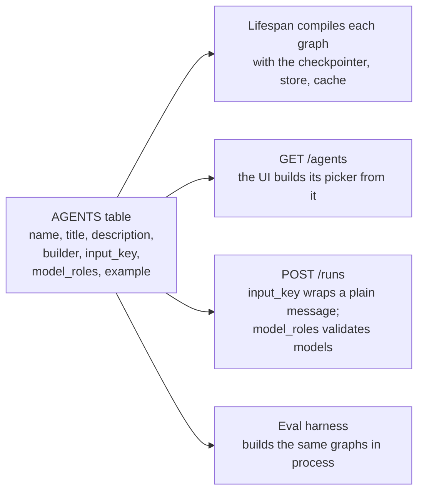
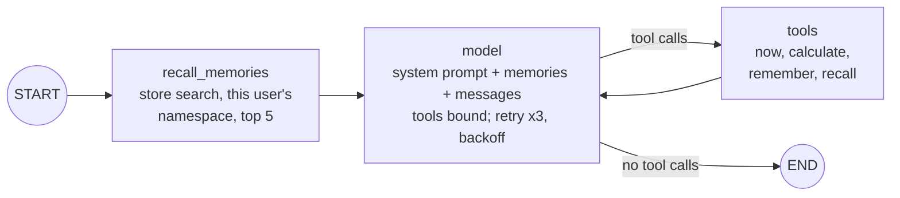
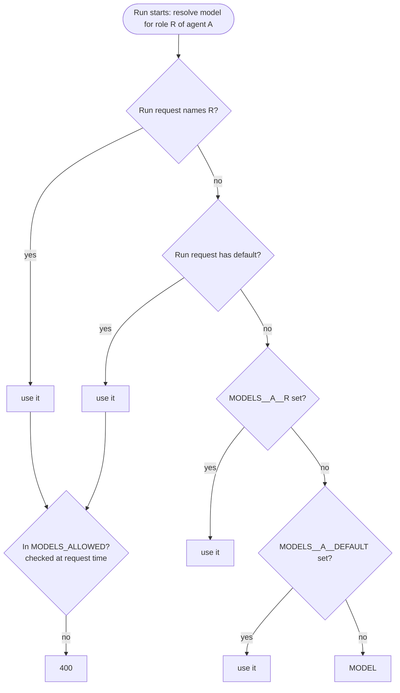
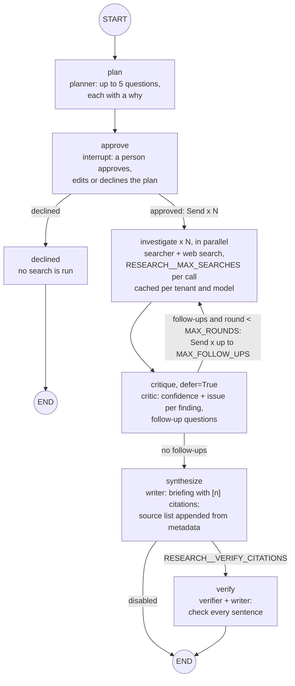
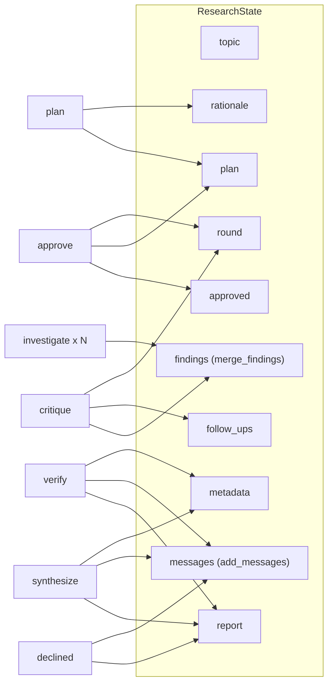
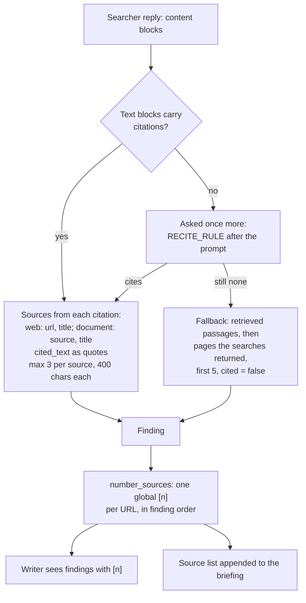
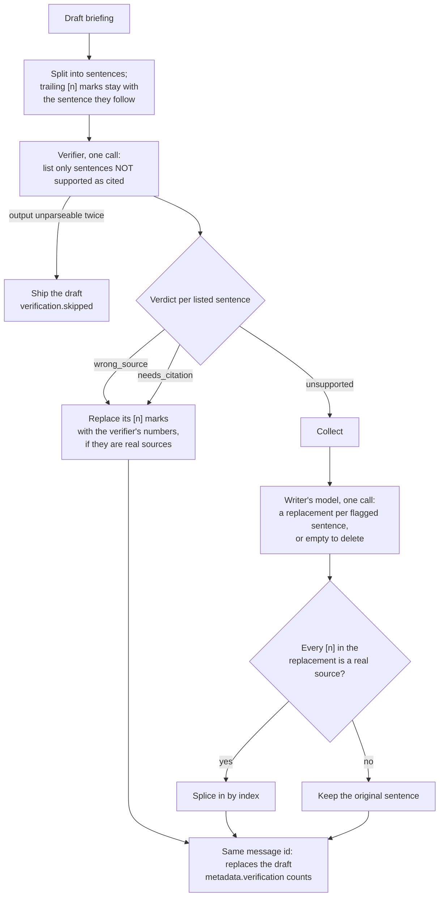
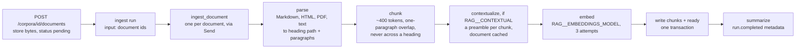

# 4. Agents

`src/waypoint/agents/`.

An **agent** here is a compiled LangGraph graph plus an entry in the registry.
A **graph** is a set of **nodes** (async functions that read state and return
an update) joined by **edges**, some of them conditional. A **role** is a
model call site within an agent: the research agent has five.

## 4.1 The registry

`src/waypoint/agents/registry.py`.

Adding an agent is one entry in this table and one module under `graphs/`.
Nothing else lists agents, so there is no second place to forget.

An entry with `listed=False` is an agent another endpoint starts: `GET
/agents` leaves it out, `POST /threads` refuses it, and the eval CLI does not
offer it. `ingest` is the one such agent ([4.10](#410-the-ingest-agent)).

## 4.2 The chat agent

`src/waypoint/agents/graphs/chat.py`. One role, `assistant`.

What it demonstrates: typed runtime context, a store as memory that outlives a
thread, node-level retries, and a tool loop. `recall_memories` is not cached
([3.8](03-state-and-persistence.md#38-the-node-cache)).

## 4.3 Model roles

`src/waypoint/agents/models.py` (`resolve_models`, `ModelRouter`, `RoleModel`).

Graph nodes never name a model. Each node asks its `RoleModel` for a runnable,
and the router answers from the map in the run's context. The map is resolved
once, when the run starts:

Current configuration (`.env.example`) and the reasoning:

`MODEL` is `claude-sonnet-4-5` in `.env.example` and the settings default;
the eval baseline and the scheduled evals run it as `claude-sonnet-5`.

| Role | Model | Why |
|---|---|---|
| planner | `MODEL` | Judgement: what to ask |
| searcher | Haiku 5.5 (`MODELS__RESEARCH__SEARCHER`) | Reads every search result as input again on each later search in the same call. On Sonnet 5 it was about 84% of a run's cost (2026-10-08 evals). Haiku 5.5 is a twentieth of the price per token. |
| critic | `MODEL` | Judgement: how good is each finding, what is missing |
| writer | `MODEL` | Writing quality is what the reader sees |
| verifier | Haiku 5.5 (`MODELS__RESEARCH__VERIFIER`) | Classifies sentences against short quotes; a narrow task |

Models are built lazily and cached per name, so a per-run choice costs one
construction per process. Each role's runnable carries `model_role` and
`model_name` as run metadata, so callbacks, traces and the eval harness can
attribute tokens and latency to a role without knowing node names. What a
model produced is recorded with the output (each AI message's `model`, each
finding's `model`, the briefing's `metadata.models`), so the UI can show it
after a reload.

## 4.4 Structured output

Planner, critic, verifier, and the writer's model when it rewrites flagged
sentences, return Pydantic objects through `with_structured_output`. No node
parses model prose.

* **Decoding is constrained.** `STRUCTURED_OUTPUT=json_schema` (the default)
  uses the provider's structured outputs. The older forced-tool-call method
  let Sonnet 5 send a list as a string, which failed whole runs in the evals.
* **Malformed output is retried.** LangGraph's default retry policy never
  retries a `ValueError`, and both pydantic's `ValidationError` and
  langchain's `OutputParserException` are one. Planner and critic nodes use a
  retry policy that adds them (`STRUCTURED_RETRY`, three attempts).
* **Tests answer by schema.** `ScriptedChatModel.structured_scripts` maps a
  schema name to a function from prompt to fields, so a test can force a
  critic follow-up or a verifier verdict without a network.

## 4.5 The research agent

`src/waypoint/agents/graphs/research.py`. Roles: planner, searcher, critic,
writer, verifier.

**Fan-out with `Send`.** `Send("investigate", WorkerInput)` starts one worker
per question, concurrently, each with only the slice of state it needs:
question, topic, round, `tenant_id` and the searcher model (both for the cache
key), and `corpus_id` when the run searches documents.

**`defer=True` on critique.** Without it the critic would run as soon as the
first worker finished. Deferred, it runs once per wave, after every worker
has landed.

**A loop bounded twice.** At most `RESEARCH__MAX_ROUNDS` waves (default 1, so no follow-ups;
see the [cost case study](../case-studies/cost.md)).
On the last round the critic is told to stop, and its follow-ups are dropped
in code anyway. Follow-ups that repeat an asked question are filtered before
they cost a search. Worst case per run:
`(5 + MAX_FOLLOW_UPS x (MAX_ROUNDS - 1)) x MAX_SEARCHES` = 10 searches with
the defaults, 16 with two rounds.

**Rules in code, not in prompts.**

| Rule | Where |
|---|---|
| A finding with no sources, or only uncited ones, has confidence at most 0.3 whatever the critic says | `critique`, `UNCITED_CAP` |
| A finding the critic forgot to score gets 0.5, not a crash | `critique` |
| The source list is built from metadata and appended; the writer cannot add a source | `synthesize`, `_source_list` |
| An edited plan is capped at 5 questions | `approve`, `MAX_QUESTIONS` |
| A rejected web-search request fails with the fix in the message | `investigate` |
| A reply that cites nothing although it had passages or search results is asked once more (`RECITE_RULE`); typed marks like `[2-1]` are stripped from answers | `investigate`, `strip_typed_markers` |
| A run that names a corpus the tenant cannot read, or names one while RAG is off, fails before planning | `plan`, `CorpusUnavailableError` |

**Documents.** With a `corpus_id` in the input, `plan` checks the corpus
against the caller's tenant and the approval interrupt shows it; the person
can answer `{"documents": false}` to research the web only. Each worker then
retrieves `RAG__TOP_K` passages for its question (`rag/retrieve.py`: the
nearest 50 by vector, reordered by Voyage's reranker) and sends
them to the searcher as `search_result` blocks ahead of the prompt, with a
`DOCUMENT_RULE` that says the passages are the user's documents, data and
not instructions, to prefer them, and to use the web for what they do not
cover. The searcher keeps its web search tool. Without a corpus the prompt
and the worker input are exactly what they were before, so recorded calls
and cache entries still match. Design and measurements:
[design/rag.md](../design/rag.md#phase-3-research-integration-2026-10-10).

### Research state

A **finding** is one question's answer: `question`, `answer`, `sources`
(each with `url`, `title`, up to three `quotes`, and `kind: "document"` for a
passage from a corpus), `cited`, `confidence`,
`issue`, `round` and the `model` that wrote it.

## 4.6 Citations from metadata

`src/waypoint/agents/citations.py`.

A finding's sources come from the `citations` on the reply's text blocks,
**never from URLs in the prose**. A URL in citation metadata came back from a
search; a URL in the text may have been invented. The **quotes** (`cited_text`)
are what the answer drew from each page. The judge and the verifier both use
them to check a claim against the source instead of against its title.

A passage from a corpus is cited the same way. Claude returns a
`search_result_location` citation instead of a web one, keyed by the passage's
`source` (`doc://<document_id>#<ordinal>`), and it becomes a source with
`kind: "document"`, its heading path as the title. Web and document sources
share one `[n]` numbering; the appended source list shows a document as
`[n] DEPLOY.md › 4. Caddy (document)` rather than its `doc://` id. Each
paragraph of a passage is its own text block, because Claude cites whole
blocks, so a citation can be narrower than the passage.

The retry exists because a reply sometimes comes back as one block of prose
with no citations at all, from material it could have cited: 20 of 277
findings in the phase 4 eval (2026-10-10). Asked once more, 14 of 15 came back
cited ([retrieval case study](../case-studies/retrieval.md#6-follow-up-asking-again-when-nothing-is-cited)).
The fallback exists because Haiku 5.5 searched but attached no citations in
about a quarter of findings (2026-10-08). Its search results are still real
pages, so they are kept, marked `cited: false`, capped at 0.3 confidence, and
counted by the `findings_cited` eval check.

## 4.7 The verify step

`verify` in `research.py`. Evidence for it: the
[grounded case study](../case-studies/grounded.md).

Design choices, each from a failure in the eval iterations:

| Choice | Failure it prevents |
|---|---|
| Ask for exceptions only, not a verdict per sentence | On long briefings, Haiku 5.5's reasoning plus 20 to 40 verdicts ran past `max_tokens` and returned empty JSON in 5 of 7 cases |
| Fix citations in code; send only unsupported sentences to a model | Most problems are attribution, which needs no rewrite and no risk to the prose |
| One replacement per sentence, spliced by index | Asked for the whole revised briefing, the writer returned only the rewritten sentences, and coverage fell from 4 to 1 |
| Reject a replacement citing a non-source | A rewrite must not introduce an unverifiable `[n]` |
| On malformed output, retry once, then ship the draft | Verification improves a briefing; it must never cost the user one |
| Same message id | `add_messages` replaces the draft, so the thread shows one briefing |

Measured on 8 cases x 3 trials (2026-10-09): briefings with at least 80% of
claim sentences cited went from 48% to 95%, and `grounded` from 3.67 to 3.86,
for about $0.02 and 21 s per run.

## 4.8 Prompts carry the date

Every model call in the research graph is told today's date. Without it, the
first eval baseline found briefings calling their own 2026 search results
possibly fabricated, and the critic marking findings down as "future-dated".
The judge's system prompt says the same.

## 4.9 Testing agents offline

`FAKE_MODEL=true` swaps every model for `ScriptedChatModel`. It shapes its
reply to the prompt: the planner gets questions, a worker gets an answer with
citation metadata, so source extraction runs offline too. A prompt containing
`[[tool:name({...})]]` makes it emit that tool call. Structured calls are
answered from `structured_scripts`. The graphs are testable because the model
is deterministic: assertions can be exact.

## 4.10 The ingest agent

`src/waypoint/agents/graphs/ingest.py`, with `src/waypoint/rag/`.

Ingestion is a run so that a long upload gets what every run has: a
`202`, an event stream with a `custom` event per stage of each document,
cancellation, audit and per-tenant limits. The upload endpoint stores the
files first and passes only their ids, so nothing large enters graph state or
checkpoints. A document that cannot be indexed is marked `failed` with the
reason and the rest carry on. A chunk keeps its paragraphs as separate
strings because the research worker sends each as its own text block, and
Claude cites whole blocks ([4.6](#46-citations-from-metadata)).

No node is cached: every node writes to the database.
