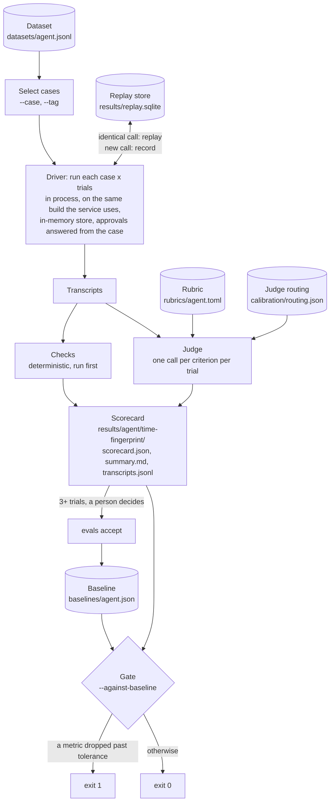
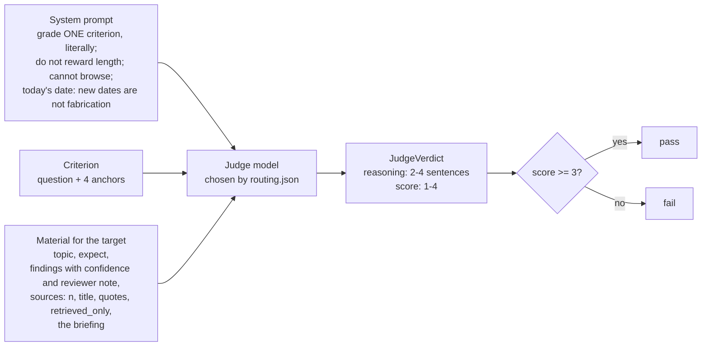
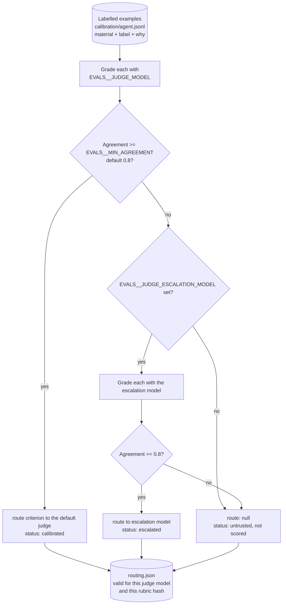
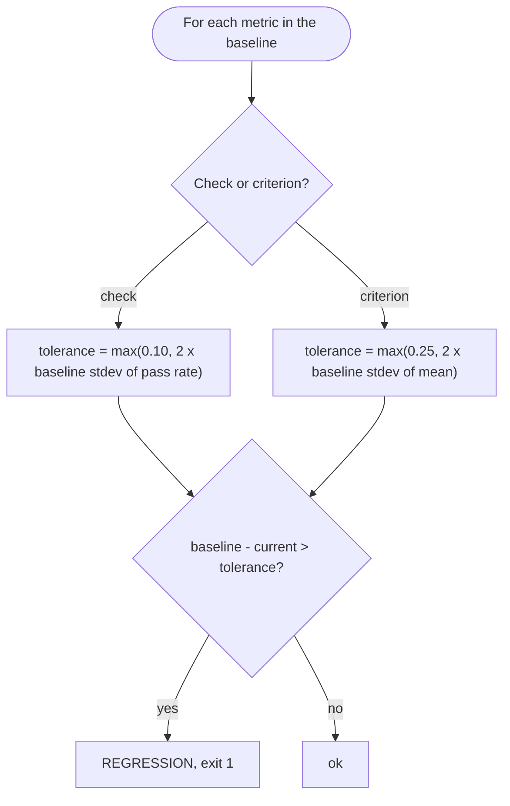
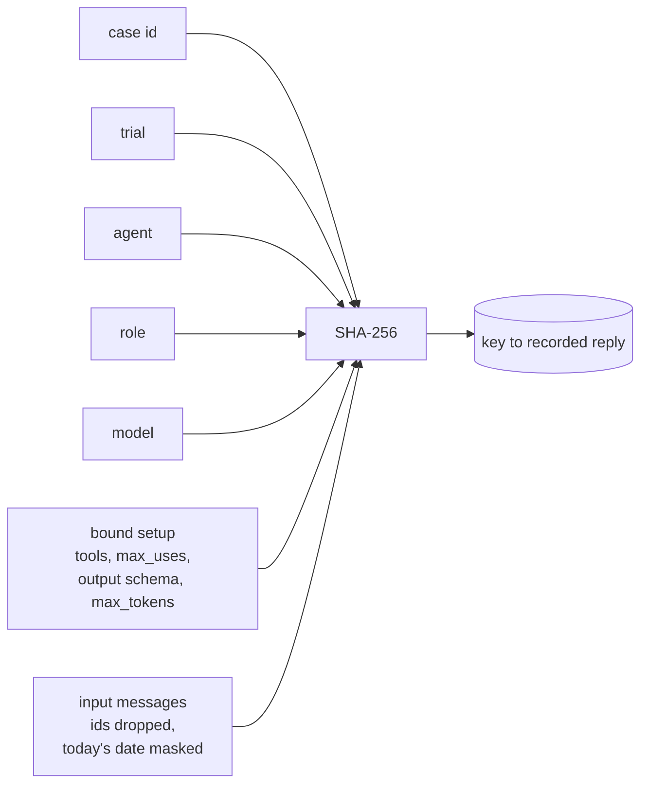
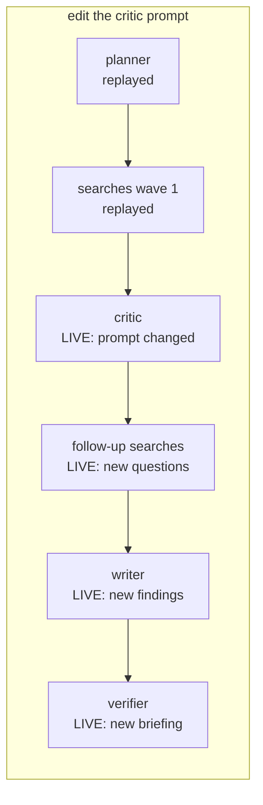
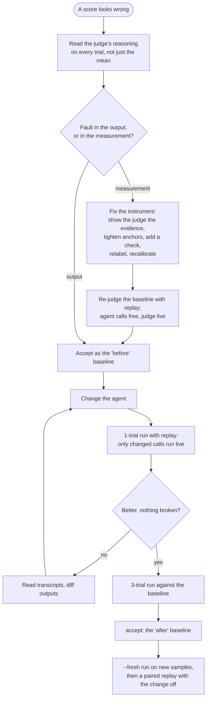

# 5. Evaluation

`evals/`. Commands: `uv run python -m evals run|compare|calibrate|accept|fingerprint`.

Unit tests prove the plumbing works. They cannot say whether a briefing is
any good, because the model in them is scripted. **Evals** measure the agents
with real models, and turn "the briefings seem fine" into numbers that can be
compared across prompts, models and weeks.

## 5.1 Tests and evals

| | Tests (`pytest`) | Evals (`python -m evals`) |
|---|---|---|
| Model | Scripted, deterministic | Real, sampled |
| Output | Pass or fail | Scores with a spread |
| Asserts | Exact behaviour of code | Quality of agent output |
| Cost | Free, about 2 s | Dollars per full run, cents with replay |
| Runs | Every commit | On demand, and weekly in CI |
| Fails when | Code is wrong | Quality drops past a tolerance |

## 5.2 Vocabulary

The full list is in the [glossary](glossary.md). The terms this chapter
leans on:

| Term | Definition |
|---|---|
| **Eval** | A repeatable measurement of an agent's output quality over a fixed set of inputs |
| **Dataset** | The fixed inputs for one agent: `evals/datasets/<agent>.jsonl`, one case per line |
| **Case** | One input plus what to check about its output and what a good answer covers |
| **Trial** | One run of one case. The same case is run several times because models are sampled |
| **Transcript** | Everything one trial produced: final state, messages, every model call with role, model, tokens and latency |
| **Check** | A deterministic test on a transcript, written in code. Pass, fail, or not applicable |
| **Rubric** | The list of criteria an LLM judge grades, for one agent: `evals/rubrics/<agent>.toml` |
| **Criterion** | One property of the output, phrased as a question with a 1 to 4 scale. "Is every claim supported by a cited source?" |
| **Anchor** | The written description of what each score on a criterion's scale means |
| **Judge** | A model that grades one criterion of one output against its anchors |
| **Grade** | One judge verdict: reasoning first, then a score of 1 to 4. 3 or 4 passes |
| **Calibration** | Measuring the judge against human labels before trusting it |
| **Scorecard** | The aggregate of one eval run: check pass rates, criterion means, spreads, usage, cost |
| **Fingerprint** | A hash of everything that can change a score, so two scorecards can be compared honestly |
| **Baseline** | An accepted scorecard that later runs are compared with |
| **Gate** | The rule that fails a run when a metric drops past its tolerance |
| **Replay** | Answering a model call from a stored recording of an identical earlier call |

## 5.3 The pipeline



The driver runs graphs in process rather than through the HTTP API. The eval
measures the agent, not the network, and it can record every model call
through a callback with the role that made it.

## 5.4 Datasets and cases

A research case:

```json
{"id": "sodium-ion-grid",
 "input": "sodium-ion batteries versus lithium-ion for grid storage",
 "checks": {"citations_resolve": true, "sources_cited": true, "findings_sourced": true,
            "findings_cited": true, "claims_cited": true, "plan_bounds": true,
            "rounds_bounded": true, "distinct_questions": true},
 "expect": "Compares cost, energy density, cycle life and safety; names commercial deployments or manufacturers; says where sodium-ion wins and where it does not.",
 "tags": ["web", "comparison"],
 "reviewed": "2026-10-07"}
```

| Field | Purpose |
|---|---|
| `id` | Stable name; part of every replay key and scorecard row |
| `input` | The user's message |
| `checks` | Which deterministic checks apply, with an argument where one is needed |
| `criteria` | Which rubric criteria to grade; empty means all |
| `expect` | What a good answer covers. The judge sees it for `covers`; it is not a reference answer to match |
| `resume` | Answers to interrupts, in order; the default approves the plan |
| `seed` | Memories stored for the case's user before the first turn (chat, workspace) |
| `corpus` | A pinned corpus under `evals/corpora/` the run searches (research) or the thread selects (workspace) |
| `judge` | `false` skips the judge for this case (checks only) |
| `tags` | For selecting subsets (`--tag web`) |
| `reviewed` | When a person last checked the case still makes sense. Topics are chosen so their core facts hold for months |

Research has 8 cases: 7 topics chosen for different failure modes (a
comparison, contested evidence, a technical mechanism, topics with a stated
scope constraint, thin evidence, recent deployments) and one that declines the
plan. Chat has 12 cases: tool use, no tool when none is needed, remembering,
using and ignoring memories, multi-turn context, and not inventing an unknown
fact. Workspace has 10: seven over the pinned `waypoint-docs` corpus (three
questions the docs answer, a follow-up turn, one they do not cover, one that
needs no documents, one that must also use a memory) and three memory and
tool cases.

**Why so few?** Each research case costs searches and several model calls,
and three trials each are needed for a spread. Eight cases, chosen to cover
different failure modes, run three trials in a few minutes and cost cents with
replay.
The trade-off is that a one-case change moves a mean by 1/7 of a point, which
is why the gate uses spreads, not fixed thresholds.

## 5.5 Checks

Deterministic, cheap, and run before the judge. A check that does not apply
(web search off, say) reports `None` and is left out of pass rates.

| Check | Agent | Passes when | Catches |
|---|---|---|---|
| `completed` | all | The run finished with a reply | Crashes, timeouts |
| `citations_resolve` | research, workspace | Every `[n]` matches a listed source; no ranges like `[1-3]` | Invented or malformed citations |
| `sources_cited` | research | At least 30% of listed sources are cited in the body | A source list the briefing ignores |
| `claims_cited` | research, workspace | At least 80% of claim sentences (8+ words) carry an `[n]`; uncited statements about the research itself ("no field data was found", "confidence is low") are not counted | Uncited factual statements |
| `cites_documents`, `cites_web` | research, workspace | The answer cites at least one document passage (or web page) | Retrieval that ran but was not used |
| `findings_sourced` | research | Every finding has sources | Workers that answered without searching |
| `findings_cited` | research | Every finding's sources came from citations, not the fallback | Searchers that searched but cited nothing |
| `plan_bounds` | research | 1 to 5 questions | Planner ignoring limits |
| `rounds_bounded` | research | Rounds within `MAX_ROUNDS` | A loop that does not stop |
| `distinct_questions` | research | No repeated questions | Wasted searches |
| `declined_without_search` | research | A declined plan produced no findings | Work done without approval |
| `tool_called`, `tool_not_called`, `no_tools` | chat, workspace | The named tool was (or was not) called | Guessing instead of using a tool, or using one needlessly |
| `remembered`, `recalled` | chat, workspace | A fact was stored; a seeded fact was used | Broken memory |
| `reply_mentions`, `reply_excludes` | chat, workspace | The reply contains (or omits) a string | Wrong answers with a known right one |

A property that code can decide belongs in a check, not a rubric. Checks
cannot drift, cost nothing, and give the judge's scores something solid to
be read against: `claims_cited` is a check, and was the clearest signal in the
[grounded case study](../case-studies/grounded.md). Because a check reads only
the transcript, a corrected one can be applied to past runs for free:
`python -m evals recheck <results dir>` rewrites a scorecard's checks from its
saved transcripts. The [cost case study](../case-studies/cost.md) did that when
`claims_cited` turned out to count honest gap statements as failures.

## 5.6 Rubrics and the judge

`evals/rubrics/<agent>.toml`, `evals/judge.py`.

A **rubric** is a set of criteria. Each criterion has a **target** (what the
judge is shown: the plan, the briefing, or a chat reply), a **question**, and
four **anchors**. From the research rubric:

```toml
[criteria.calibrated]
target = "briefing"
question = "Where findings have low confidence or a reviewer note, does the briefing say so instead of stating the claim as settled fact? ..."
1 = "Presents weak or contested findings as settled fact."
2 = "Flags some weak findings but states at least one as fact."
3 = "Flags the weak findings; the hedging is vague in places."
4 = "Each weak or contested point is clearly marked as such; strong points are stated plainly. ..."
```

| Agent | Criteria |
|---|---|
| research | `plan_quality` (plan), `grounded`, `covers`, `calibrated`, `useful` (briefing) |
| chat | `correct`, `uses_memory`, `honest_tools` |
| workspace | `correct`, `uses_memory`, `honest_tools` (reply), `grounded` (the last reply as a briefing: each search is a finding, its passages the evidence) |

Workspace's criteria are uncalibrated until it has labelled examples
(`calibration/workspace.jsonl`); until then the default judge grades them and
the scorecard marks them `uncalibrated`.

### Anatomy of one judge call



Principles, and why:

* **One criterion per call.** A single "overall quality" score hides which
  property regressed, and a model asked several things at once lets one
  answer colour the others.
* **Reasoning before the score.** The score is conditioned on stated reasons,
  and the reasons are what a person reads when a score looks wrong. Reading
  them is how the grounded investigation started.
* **A short scale with written anchors.** Four points with a description each
  are more repeatable than ten without. There is no middle score to hide in;
  3 and 4 pass.
* **Show the evidence.** The judge cannot browse. It sees the findings and,
  for each source, the text the answer quoted from it. *Grounded* means
  grounded in what the agent retrieved, not true in the world.
* **Structured output.** The verdict is a schema, not parsed text.
* **No self-judging.** `self_judging()` warns when a criterion's judge is the
  same model that produced what it grades.

## 5.7 Calibration

`evals/calibration/<agent>.jsonl`, `evals/calibrate.py`, `routing.json`.

A judge is a model, so its grades are a measurement with an error. Before a
criterion's scores are trusted, the judge is measured against **labels**:
outputs a person scored using the same anchors.



* **Agreement** is the share of examples where judge and label agree on pass
  versus fail (3 to 4 versus 1 to 2). That is the decision the gate depends on.
* **Mean absolute error** (MAE) is reported next to it, to show how far off the
  misses are.
* **Routing is tied to what it measured.** It records the judge model and a
  hash of the rubric file plus the judge's prompt templates. Change any of
  them, and every criterion reads as `uncalibrated` until `calibrate` runs
  again.
* **Escalation is per criterion.** A cheap judge grades what it can, and only
  the criteria it fails go to a stronger model.

Calibration as of 2026-10-09 (research):

| Criterion | Judge | Agreement | MAE |
|---|---|---|---|
| `plan_quality` | Haiku 4.5 | 90% | 0.40 |
| `grounded` | Opus 4.5 (escalated; Haiku 4.5 scored 75%) | 92% | 0.17 |
| `covers` | Haiku 4.5 | 90% | 0.30 |
| `calibrated` | Haiku 4.5 | 90% | 0.50 |
| `useful` | Haiku 4.5 | 90% | 0.60 |

**How good labels are made.** The twelve `grounded` labels were built in
groups of three from real briefing paragraphs: the real text, the same text
with its citations corrected, and a version with one planted error (an
invented claim, a citation swapped to an unrelated source, or citations
removed). Planted errors give examples with a known right answer; real text
keeps the examples representative. A person agreed every label before any
judge saw it, and the reasoning is kept in
`calibration/research.grounded.review.md`.

## 5.8 Scorecards, fingerprints and the gate

`evals/scorecard.py`.

A **scorecard** holds, per check, the pass rate, and per criterion, the mean
score and pass rate. Each comes with its **spread**: the standard deviation
across trials. It also records each criterion's judge status (`calibrated`,
`escalated`, `untrusted` or `uncalibrated`; the model that graded is on each
run's grades), usage and cost per role, replayed call counts, the git SHA, and
the fingerprint.

The **fingerprint** is a 12-character hash of: every prompt the agent uses,
the resolved model per role, the agent's settings, `MAX_TOKENS`, the judge
model, the rubric, and the dataset. Two scorecards with the same fingerprint
measured the same thing. When they differ, the summary says so, because a
change in score may then be a change in the ruler.



* **Why twice the spread.** Trials of the same configuration differ. A drop
  inside twice the baseline's own trial-to-trial spread is not evidence of a
  change.
* **Why floors.** Three trials can agree by chance and report a spread near
  zero. The floors stop a tiny spread from turning noise into a failure.
* **Why `accept` needs three trials.** One trial has no spread, so its
  tolerance would be only the floor. `--min-trials` overrides, deliberately.
* **Only drops fail.** An improvement is accepted by a person running
  `accept`, after reading the transcripts.

## 5.9 Replay

`evals/replay.py`.

Most experiments change one role. Without replay, a writer-prompt change
re-runs every search, and the searcher was about 84% of a run's cost. With
replay, every model call is stored under a key made of **exactly what was
sent**:



Change anything that reaches the API, and the key changes, so the call runs
live. Everything downstream then runs live too, because its input changed:



| Flag | Reads stored calls | Records new ones | Use |
|---|---|---|---|
| (default) | yes | yes | Iterating on a prompt, model or setting |
| `--fresh` | no | yes (replacing) | Sampling the live models and web again |
| `--no-replay` | no | no | CI: measure the world as it is now |

* **The trial is in the key**, so three trials replay three independent
  samples, not one sample three times.
* **What replay cannot see is the outside world.** Replayed searches are the
  web as it was when recorded. Use `--fresh` before accepting a baseline you
  mean to keep.
* **The store lives beside `--out`.** A new `--out` directory starts an empty
  store and pays for every call.
* **Paired comparisons.** Because a fresh run records every call, a second
  run with one setting changed replays everything else. The grounded case
  study used this to compare the same briefings with and without the verifier.

## 5.10 Compare

`evals compare --agent research --b critic=claude-opus-4-5` runs two
configurations on the same cases and asks the judge, per criterion, which
output is better, with A and B in shuffled order to cancel position bias. It
reports win rates next to cost and check pass rates, which is the question a
model choice actually poses: is B better enough to be worth its price? Both
sides share the replay store, so roles they have in common run once.

## 5.11 The improvement loop

How a quality problem is worked, as practised in the
[grounded case study](../case-studies/grounded.md):



The step that matters most is the second decision. In the grounded work, the
low score was mostly the instrument: re-scored by a calibrated judge that
could see the quotes, the unchanged briefings went from 2.48 to 3.67.

## 5.12 Scheduled evals

`.github/workflows/evals.yml` runs the full dataset against live models,
without replay, with `--against-baseline`. It wakes daily and a first job
decides whether today is a run day, so the cadence is a repository variable
(`EVALS_CADENCE`: `weekly`, `nightly`, `off`), not a code change. A
regression fails the run and GitHub emails it; scorecards and transcripts are
kept 90 days as an artifact. The workflow's `env` must repeat the configuration
the baseline was accepted with (models per role included), or the
fingerprints differ and the summary says the comparison is between two setups.

A failure on a commit that changed nothing usually means the world moved: web
results, a model alias pointing at a new snapshot, or a case whose "recent"
facts went stale. The transcripts say which.

## 5.13 Cost

| Run | Approximate cost | Source |
|---|---|---|
| Research, 8 cases x 3 trials, every role on Sonnet 5, no replay | $18.50 | 2026-10-08 scorecard |
| Same, searcher on Haiku 5.5 | about $7.60 | workflow estimate |
| Writer-prompt change, replayed | about $0.90 | TESTING.md |
| Verifier iteration, 1 trial, replayed | $0.04 agent cost per run, plus judge | 2026-10-09 scorecard |
| Fresh 1-trial research run | $0.27 per run, $2.16 for 8 cases | 2026-10-09 scorecard |
| Retrieval eval, ten configurations, index reused or rebuilt | about $0.05 (Haiku preambles); Voyage calls inside the free tier | 2026-10-10 scorecards |
| Research corpus cases live, 5 cases x 3 trials, web cases replayed | $2.84 to $3.04 | 2026-10-10 scorecards |
| Citation retry, 13 cases x 3 trials, corpus cases live | $3.97 | 2026-10-10 scorecard |

Judge calls are not priced on scorecards. `src/waypoint/prices.toml` holds the
rates used, with the date they were checked; `waypoint/usage.py` applies them,
the same code the service will use to price runs.

## 5.14 What this approach does not do

* **Small samples.** Eight research cases and three trials detect large
  changes, not subtle ones. One case moving one point moves a mean by 0.14.
* **The judge sees what the agent retrieved, not the world.** A briefing can
  be faithfully grounded in a wrong source.
* **Labels are few.** Five criteria with 10 to 12 labels each. Agreement of
  90% on ten examples is an estimate with a wide interval.
* **Replay freezes the web.** Iterations are measured on one sample of search
  results per trial; a fresh run is needed to see generalisation.

## 5.15 The retrieval eval

Answer evals measure retrieval only through everything after it, at dollars
per run. The retrieval eval measures it alone, with no model at query time:
40 reviewed queries over this repository's `docs/` pinned to a commit, each
labelled with the quoted spans that answer it, scored as recall@5/8/12/20 and
MRR per search mode and per query kind, with latency and cost. Its index is
stored under a fingerprint, so a rerun pays only for query embeddings and
rerank calls. It has its own baseline and a fixed gate (a drop of 0.05),
because retrieval is deterministic enough that there is no trial spread to
measure. Commands and details: [TESTING.md](../TESTING.md#retrieval-eval);
what it found: [case study](../case-studies/retrieval.md).

What it cannot see: whether the searcher cites what it was given. Phase 4
raised retrieval MRR from 0.80 to 0.90 and the corpus cases' `grounded` fell,
because uncited findings doubled. Both evals are needed.
