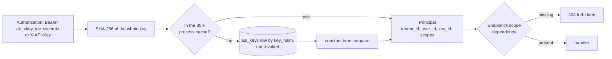
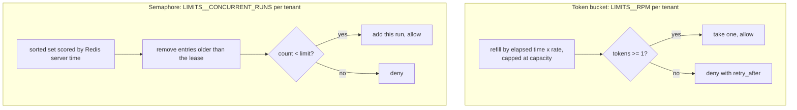
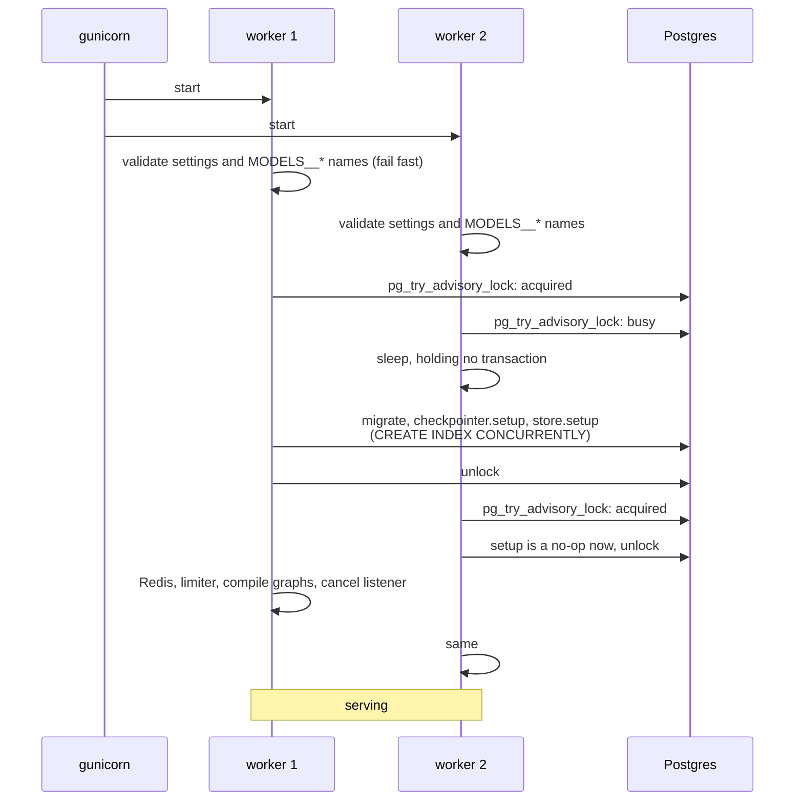

# 6. Security and operations

## 6.1 Authentication and scopes

`src/waypoint/infra/security.py`, `src/waypoint/api/deps.py`, `src/waypoint/api/keys.py`.



* **Only a hash is stored**, and the lookup is by that hash. Someone who
  reads the database cannot use what they find. The plaintext exists once, in
  the `POST /keys` response. The key id in the prefix names the key for
  revocation and in logs without revealing the secret.
* **Scopes** are `threads:read`, `threads:write`, `agents:run` and
  `keys:admin`; `*` grants all. `tenant:admin` additionally lets a caller
  open threads of other users in its own tenant. Endpoints declare theirs through typed
  dependencies (`Reader`, `Writer`, `Runner`, `Admin`), so a handler cannot
  forget to check.
* **Revocation** clears the cache on the worker that handled it; other workers
  pick it up within 30 s.
* **Bootstrap.** `BOOTSTRAP_API_KEY` seeds one key at startup for local
  development. Leave it unset in production.
* **Swapping auth.** Everything downstream depends on `Principal`, not on how
  it was made. JWT verification would replace the key lookup and nothing else.

## 6.2 Tenant isolation

### Tenants and users

A **tenant** is the organisation or customer account a group of users
belongs to: a company using the service, such as `acme`. A **user** is one
person within it. The tenant is the outer isolation boundary and the user an
inner one.

A tenant is a label on an API key, not a managed entity: there is no tenants
table. An admin names both when creating a key
(`POST /keys {"tenant_id": "acme", "user_id": "alice", ...}`), and every
request with that key resolves to a principal of tenant `acme`, user `alice`.
The bootstrap key belongs to tenant `bootstrap`; with auth off every caller is
tenant `public`.

| | Per tenant | Per user within the tenant |
|---|---|---|
| Threads | Another tenant's thread is 404, as if it did not exist | Another user's thread is 403, unless the key has `tenant:admin` |
| Long-term memory | Part of the namespace | Also part of it: `("memories", tenant, user)` |
| Rate and concurrency limits | Yes: 60 run starts per minute, 4 concurrent runs | No: users share their tenant's quota |
| Node cache (search answers) | Never shared across tenants | Shared between users of one tenant |
| Run audit and traces | Tagged by tenant | Recorded with the user |

The two levels have different jobs. The tenant is the boundary you would sell
and bill against: one customer's data, quota and cached results must never
touch another's. The user boundary is privacy within a customer: colleagues
share a quota and cached search answers, but not conversations or memories.
The same user id in two tenants is two unrelated users.

### Where isolation is enforced

Isolation is enforced at each place data could cross between tenants:

| Surface | Mechanism |
|---|---|
| Threads | `threads` table records the owning tenant and user; every request naming a thread checks both. Another tenant's thread is **404, not 403**: a 403 would confirm the id exists, which leaks when ids appear in URLs and logs. Another user's thread in the same tenant is 403 unless the key has `tenant:admin` |
| Runs | The run record carries the tenant; reading, streaming or cancelling another tenant's run is 404 |
| Graph state | Identity is in context, never state or `configurable`, so it is never checkpointed ([3.5](03-state-and-persistence.md#35-context-state-and-config)) |
| Memories | Namespace `("memories", tenant_id, user_id)`, from one function used by both graph and API |
| Corpora | Two guards: every query in `rag/store.py` filters `tenant_id`, and each runs as the `waypoint_tenant` role with `app.tenant_id` set, so Postgres row-level security filters again. The role is needed because the service's own user owns the tables (and is a superuser in compose), and owners bypass RLS. Public corpora are readable by all and writable only by the owner role ([ARCHITECTURE.md §8a](../ARCHITECTURE.md)) |
| Node cache | Keys hash node input only, so cached nodes carry `tenant_id` in their input; per-user nodes are not cached ([3.8](03-state-and-persistence.md#38-the-node-cache)) |
| Limits | Buckets and slots are per tenant |
| Traces | Each run is tagged `tenant:<id>` and `agent:<name>` |

`tests/test_isolation.py` covers the cache cases; the integration tier covers
keys and tenants against real Postgres and Redis, and `tests/test_rag_pg.py`
covers corpora: the store, raw SQL under RLS with no or the wrong tenant, and
the API with a second tenant's key.

## 6.3 Rate and concurrency limits

`src/waypoint/infra/ratelimit.py`.

Two workers each reading a counter, both seeing "3 of 4 used", both
proceeding: that is how limits fail under exactly the load they exist for. So
each limit is **one Lua script**, and the check and the write happen as one
atomic step in Redis.



* **A token bucket, not a fixed window.** A fixed window lets a caller spend
  one minute's budget in its last second and the next minute's in the first.
* **Server time, not worker clocks**, so skew between hosts cannot widen a
  slot's lifetime.
* **A lease**, set to the run timeout plus 30 s, so a worker that dies mid-run
  cannot hold a slot forever.

## 6.4 Errors

`src/waypoint/errors.py`. Every failure that leaves the service is
`application/problem+json` (RFC 9457) with a stable `type` slug, a title, a
detail and the `request_id`:

```json
{"type": "https://errors.waypoint.local/rate-limited", "title": "Too Many Requests",
 "status": 429, "detail": "Rate limit of 60/min exceeded.",
 "request_id": "0f0e...", "retry_after": 0.86}
```

Clients branch on the slug; people grep the request id. Validation errors list
each problem's location and message but never echo the input, so a malformed
body containing a secret does not end up in a log aggregator. An unhandled
exception becomes a 500 problem in the ASGI middleware, which, unlike a
FastAPI exception handler, can still add `X-Request-ID`.

## 6.5 Observability

| Signal | Where | Notes |
|---|---|---|
| Request id | `X-Request-ID` header in and out; every log line; every problem body | Set by the middleware, bound to a ContextVar |
| Access log | `waypoint.access` logger, JSON with `JSON_LOGS=true` | Successful health probes log at DEBUG, failing ones at INFO |
| Run audit | `run_audit` table | Every run's tenant, user, agent, status, error, start and end |
| Run events | Redis Streams | The full event history of a run for an hour after it ends |
| Model attribution | Message, finding and briefing metadata; per-role run metadata | Which model produced what, kept in the checkpoint |
| Traces | LangSmith when `LANGSMITH_TRACING=true` | Tagged by tenant and agent; roles visible in metadata |
| Eval scorecards | `evals/results/` and CI artifacts | Quality, cost and latency per role over time |

The middleware is a plain ASGI class, not Starlette's `BaseHTTPMiddleware`.
That one runs the endpoint in a separate task, which loses the log
ContextVar and interferes with streaming responses.

## 6.6 Boot and shutdown

`src/waypoint/__init__.py` (lifespan), `src/waypoint/agents/runtime.py`,
`src/waypoint/infra/db.py`.



**Why a polled lock, not a blocking one.** LangGraph's setup runs `CREATE
INDEX CONCURRENTLY`, which waits for every in-flight transaction to finish. A
worker parked inside a blocking `pg_advisory_lock` *is* an in-flight
transaction. So the lock holder waits for the waiter, which waits for the
lock holder. Postgres does not count that as a deadlock, so neither side times
out and the service hangs at boot with no error. Polling with
`pg_try_advisory_lock` leaves the waiter idle between attempts.
`tests/test_integration.py` boots three apps at once against a dropped schema
to keep it that way.

**Fail fast.** Settings are typed and validated before any connection opens:
an unknown agent or role in `MODELS__*` stops the boot with the valid names; a
stream block that is not at least 1 s shorter than the Redis socket timeout is
refused; an
empty `${VAR:-}` from compose counts as unset rather than as an empty key.

**Shutdown** cancels runs in flight and closes pools within 20 s;
gunicorn's graceful timeout is 30 s. A run cancelled by shutdown ends in
`cancelled` and releases its slot.

## 6.7 Health

| Endpoint | Checks | Use |
|---|---|---|
| `GET /api/v1/healthz` | nothing | Liveness; the container healthcheck |
| `GET /api/v1/readyz` | Postgres and Redis ping, graphs compiled | Readiness; `503` when a configured backend is down |

`off` in a readiness check means not configured; `down` means configured and
unreachable. Only `down` fails readiness, so a development instance with no
Redis is still ready.

## 6.8 Running without infrastructure

With `DATABASE_URL` and `REDIS_URL` unset, the service falls back to an
in-memory checkpointer and store, a single-process event bus, and no limits,
and logs a warning for each. That is how the unit tests run and how a laptop
runs without Docker. The fallbacks implement the same interfaces, which is
what keeps the unit tier honest; what they cannot do (resume across workers,
survive a restart) is what the integration tier tests.

## 6.9 Failure modes

| Failure | Effect | Recovery |
|---|---|---|
| Client connection drops | None on the run | Client reconnects with `Last-Event-ID` |
| SSE reader errors | Response ends without a terminal event | Client treats it as a drop and reconnects |
| Worker restarts mid-run | That run's task dies and its record is left as `running` | Slot lease expires; checkpoint history is intact up to the last step (no queue: [decision 11](07-decisions.md#d11-no-job-queue-yet)) |
| Run exceeds 300 s | `run.failed` with type `timeout` | Raise `LIMITS__RUN_TIMEOUT_S` or lower research bounds |
| Model returns malformed structured output | Retried up to 3 times by the node | Verify step degrades to the unverified draft |
| Web search rejected by the provider | Run fails with the fix in the message | Enable web search for the org, or `RESEARCH__WEB_SEARCH=false` |
| Redis down | Runs cannot start or stream; readiness fails | Restore Redis; checkpoints are in Postgres |
| Postgres down | Runs fail; readiness fails | Restore Postgres |
| Node cache entry corrupt | Logged and dropped | None needed |

## 6.10 Container details

* `WORKDIR /waypoint` would create the directory as root, and `COPY --chown`
  changes only what it copies, so the image creates `/waypoint` owned by the
  `waypoint` user before copying. Otherwise the unprivileged user cannot write
  to its home.
* gunicorn 26 opens a control socket under `$HOME/.gunicorn` by default, and
  the `waypoint` user's home is `/waypoint`. Nothing uses it, so the command passes
  `--no-control-socket`.
* nginx proxies `/api/` with buffering off and a one-hour read timeout.
  Buffering is what makes streamed tokens arrive in one lump at the end.
